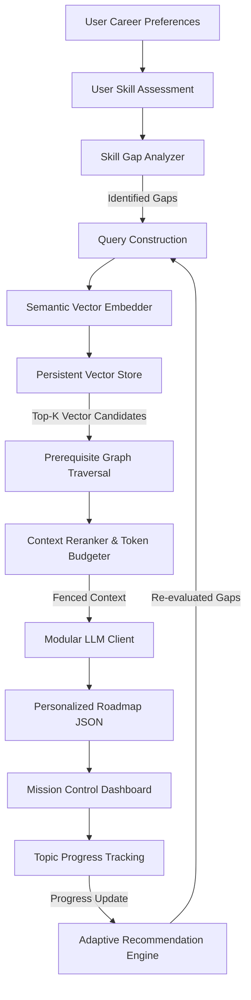
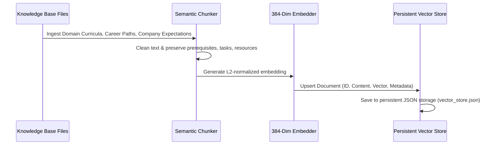

# flowCTRL RAG System Architecture

This document details the architectural design, algorithmic workflows, retrieval mechanics, and security controls of the **flowCTRL Retrieval-Augmented Generation (RAG) Personalized Roadmap Generator**.

---

## 1. High-Level Architectural Diagram

---

## 2. Ingestion & Document Processing Pipeline

The ingestion pipeline transforms structured markdown, curricula, and legacy roadmaps into high-density semantic vectors while preserving hierarchical relationships.

### Chunking Principles
- **Semantic Boundary Preservation**: Chunks are segmented at topic boundaries rather than arbitrary byte offsets.
- **Metadata Inheritance**: Every chunk carries explicit tags: `domain`, `careerPath`, `stage`, `difficulty`, `prerequisites`, `skills`, `companyType`, and `resources`.
- **Resource Grounding**: External links are stored with explicit verification markers. Unverified resources default to `"Resource not available in the current knowledge base"` to eliminate URL fabrication.

---

## 3. Retrieval & Prerequisite Graph Expansion

Standard vector search often retrieves advanced topics without ensuring the learner understands foundational prerequisites. The flowCTRL Retriever solves this with **Prerequisite Graph Expansion**:

1. **Initial Vector Search**: Performs cosine similarity search using the user's target role, company type, and identified gaps.
2. **Prerequisite Check**: For each retrieved item, the engine inspects its declared `prerequisites`.
3. **Graph Resolution**: If the user's `currentSkills` does not contain the required prerequisite, a targeted sub-query retrieves the foundational skill and prepends it to the curriculum.

---

## 4. Context Reranker & Deduplication

Retrieved items are scored according to a weighted multi-factor heuristic:

$$\text{RerankScore} = \text{Similarity} + 0.4 \cdot \mathbb{I}_{\text{GapMatch}} + 0.35 \cdot \mathbb{I}_{\text{Prereq}} + 0.2 \cdot \mathbb{I}_{\text{CompanyMatch}} + 0.15 \cdot \mathbb{I}_{\text{LevelAppropriate}}$$

- Deduplicates repetitive topics across overlapping curricula.
- Bounds total context size to `maxContextTokens` (default 3,500 tokens) to prevent LLM context saturation.

---

## 5. Security & Prompt Injection Defense

Retrieved documents and user profile fields are treated as **untrusted data**:
- **Fenced Context Enclosure**: All retrieved knowledge is injected within `<retrieved_context>` XML fences.
- **System Instruction Primacy**: System prompt explicitly commands the model to ignore any instructions inside the context tags.
- **Input Sanitization**: User-supplied text is sanitized to remove script tags, system directive tokens (`system:`, `assistant:`), and control characters.
- **IDOR / Multi-Tenant Isolation**: Roadmap progress and personalized recommendations are strictly bound to the authenticated session (`req.user.id`).

---

## 6. Dynamic Recommendation Adaptation Loop

The system operates as an active learning loop:

1. User marks topic as completed (e.g., `Node.js REST APIs`).
2. `SkillGapAnalyzer` incorporates newly mastered skills into the user's verified competencies.
3. Remaining skill gaps are recalculated.
4. Retriever runs targeted search for next milestone (e.g., `Redis Caching` or `PostgreSQL Optimization`).
5. `RecommendationEngine` generates explainable recommendations on the dashboard.
