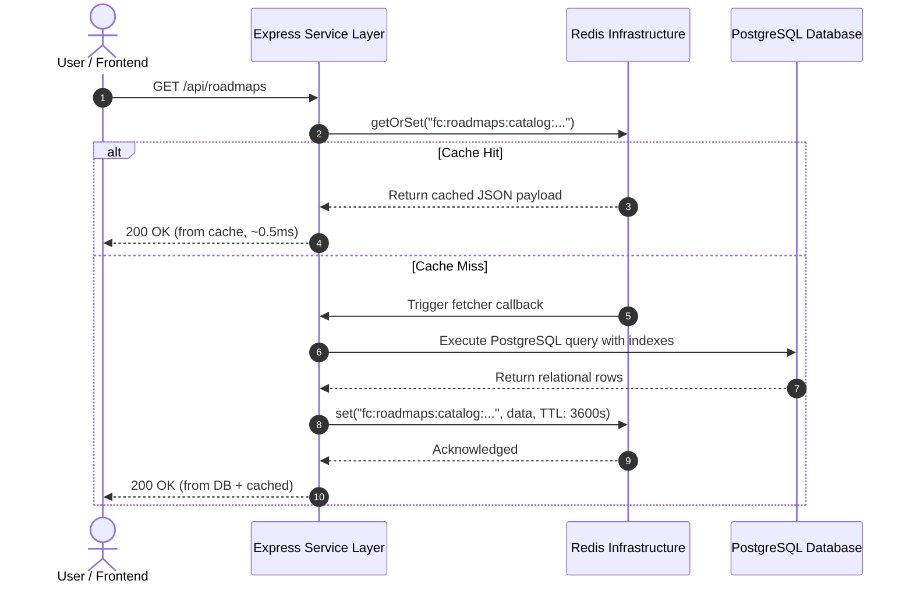

# flowCTRL Cache-Aside Strategy & Invalidation Architecture

## 1. Cache-Aside Pattern (Lazy Loading)

flowCTRL enforces the standard **Cache-Aside** design pattern across all read-heavy services:



---

## 2. Protection Against Cache Stampedes (Dogpiling)

### The Problem
When a high-traffic cache key expires or is invalidated, hundreds of concurrent incoming requests simultaneously detect a cache miss and execute the expensive PostgreSQL query, causing sudden database connection pool exhaustion and CPU spikes.

### The flowCTRL Solution: Single-Flight Mutex Memoization
In `apps/backend/src/lib/redis/cache.js`, `getOrSet()` incorporates an in-flight promise map (`inflightPromises`):
1. The first request that encounters a cache miss creates an async promise (`flight`) and registers it in `inflightPromises.set(key, flight)`.
2. Subsequent concurrent requests for that exact same key check `inflightPromises.has(key)` and simply await the already running promise instead of querying the database.
3. Upon completion, the promise writes to Redis and deletes itself from `inflightPromises`.
4. Result: **Exactly 1 PostgreSQL query executes**, completely eliminating the cache stampede.

---

## 3. Stale-Write Race Condition Prevention

### The Classic Race Condition
In naive cache-aside implementations:
1. **Request A** reads from database (returns stale record v1).
2. While Request A's database response is in flight across the network, **Request B** updates the database to v2 and calls `cache.del(key)`.
3. The cache key is deleted.
4. **Request A** finishes its slow execution and writes its stale v1 data back into Redis (`cache.set(key, v1)`).
5. The cache is now poisoned with stale data until TTL expiration.

### The flowCTRL Solution: Invalidation-Aware CAS Timestamp Guard
`apps/backend/src/lib/redis/cache.js` incorporates real-time invalidation tombstone tracking:
1. When `getOrSet(key, fetcher)` starts, it records `const fetchStartedAt = Date.now()`.
2. When any update invalidates the key via `cache.del(key)` or `cache.delPattern(pattern)`, it records an invalidation marker:
   - In Redis: `SET fc:inv:<key> <timestamp> EX 60`
   - In Memory: `memoryStore.recordInvalidation(key, timestamp)`
3. When `fetcher` completes with data, `getOrSet()` invokes `isInvalidatedSince(key, fetchStartedAt)`.
4. If an invalidation occurred while the database query was running (`lastInvalidatedAt >= fetchStartedAt`):
   - The stale write is **aborted**.
   - The metric `raceConditionsPrevented` is incremented.
   - The fresh data is returned to Request A without polluting the cache.
   - Subsequent requests will read freshly updated data from PostgreSQL.

---

## 4. Invalidation Strategies & Mutation Triggers

To maintain relational integrity, PostgreSQL transactions must commit **before** cache keys are invalidated:

```javascript
// Example: Creating a new Job Posting in jobs.service.js
const newJob = await prisma.job.create({ data: ... });

// 1. Transaction committed successfully in PostgreSQL
// 2. Invalidate affected cache keys via non-blocking pattern deletion
await cache.delPattern(buildKey(REDIS_CONFIG.namespaces.JOBS, "*"));
```

### Invalidation Trigger Matrix

| Mutation Event | Invalidation Call | Scope of Invalidation |
|---|---|---|
| New Premium Roadmap seeded/added | `cache.delPattern("fc:roadmaps:*")` | Roadmaps catalog & detail |
| Premium Resource updated | `cache.delPattern("fc:premium:*")` | Premium catalog & detail |
| Job posting created / updated / deleted | `cache.delPattern("fc:jobs:*")` | Job listings & specific job |
| User updates profile / career goals | `cache.del("fc:rag:user:" + userId)` | User's personalized RAG profile |
| User session revoked / logged out | `cache.del("fc:session:" + tokenSuffix)` | Specific active session (plus revocation tombstone) |
| User logs out of all devices | Precision iteration over user's session tokens | Only that specific user's cached sessions |
| Skill taxonomy altered | `cache.delPattern("fc:catalog:*")` | Category & skill listings |

---

## 5. TTL Presets (Time-To-Live)

| Category | TTL Duration | Rationale |
|---|---|---|
| `STATIC_METADATA` | 86,400s (24 hours) | Category taxonomies, static curriculum nodes change rarely. |
| `ROADMAP_CATALOG` | 3,600s (1 hour) | Balances cache hit efficiency with timely catalog updates. |
| `PREMIUM_DETAIL` | 1,800s (30 minutes) | Allows timely propagation of module tweaks. |
| `JOBS_LIST` | 300s (5 minutes) | Frequent recruitment activity; balances freshness with load. |
| `DASHBOARD_STATS` | 60s (1 minute) | Mission control metrics require near-realtime responsiveness. |
| `SESSION_CACHE` | 300s (5 minutes) | Hot session authorization verification with rolling refresh. |
| `RAG_QUERY` | 1,800s (30 minutes) | Repeated career path queries reuse LLM generation. |
