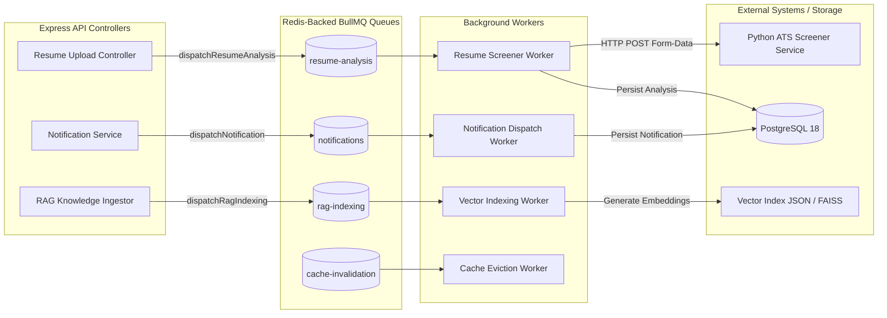

# flowCTRL BullMQ Queue & Worker Architecture

## 1. Overview

flowCTRL utilizes **BullMQ** for reliable, asynchronous background job processing. Time-consuming, resource-intensive, or external network operations are offloaded from HTTP request-response cycles to Redis-backed queues.



---

## 2. Queue Directory & Responsibilities

### 2.1 `resume-analysis`
- **Purpose**: Evaluates candidate resumes against ATS compatibility criteria and computes career match scores.
- **Payload**: `{ resumeId, userId, userRole, isUrgent }`
- **Processor**: Calls `analyzeResume()`, streaming PDF bytes to the Screener microservice or executing heuristic fallback.
- **Concurrency**: 3 concurrent workers.
- **Timeout**: 60,000ms (1 minute).

### 2.2 `notifications`
- **Purpose**: Dispatches email alerts and internal user notifications without blocking client HTTP actions.
- **Payload**: `{ userId, title, message, type, link }`
- **Processor**: Calls `createNotification()`, writing to PostgreSQL and publishing to user realtime channels.
- **Concurrency**: 5 concurrent workers.

### 2.3 `rag-indexing`
- **Purpose**: Background processing, chunking, and vector embedding updates when curriculum resources are modified.
- **Payload**: `{ domainSlug, resourceId, textChunks }`
- **Processor**: Updates vector store embeddings and purges stale retrieval caches.
- **Concurrency**: 2 concurrent workers.

### 2.4 `cache-invalidation`
- **Purpose**: Distributed bulk eviction of wide cache patterns across multiple backend instances.
- **Payload**: `{ pattern }`
- **Processor**: Executes non-blocking `delPattern()` scan with invalidation tombstoning.

---

## 3. Reliability & Retry Configuration

Every queue is configured with enterprise retry policies:

```javascript
const DEFAULT_JOB_OPTIONS = {
  attempts: 3,                   // Maximum 3 retry attempts
  backoff: {
    type: "exponential",         // Exponential backoff
    delay: 2000,                 // Initial delay: 2 seconds (2s, 4s, 8s)
  },
  removeOnComplete: {
    count: 200,                  // Retain last 200 successful jobs for inspection
    age: 24 * 3600,              // 24 hours
  },
  removeOnFail: {
    count: 1000,                 // Retain up to 1,000 failed jobs for auditing/re-queueing
    age: 7 * 24 * 3600,          // 7 days dead-letter retention
  },
  timeout: 60000,                // 60 seconds job execution timeout
};
```

---

## 4. Zero-False-Queuing Contract & Resilient Fallback

To comply with distributed reliability standards, `apps/backend/src/lib/redis/queues.js` enforces the **Zero-False-Queuing Guarantee**:
- **Never acknowledge unpersisted in-memory jobs as queued**: We strictly avoid simulating queue persistence with temporary memory queues that vanish on process crash or restart.
- **Durable Queue Mode**: When Redis is online, jobs are persisted into Redis-backed BullMQ queues and return `{ queued: true, id: job.id, mode: "durable_queue" }`.
- **Synchronous Durable Fallback Mode**: When Redis is unavailable or offline, jobs are executed immediately and synchronously via the registered processor, returning `{ queued: false, synchronous: true, mode: "synchronous_fallback", degraded: true, result }`.
- **Hard Degraded Safety**: If no handler is registered or synchronous fallback is disabled, the dispatcher returns a structured 503 `QUEUE_DEGRADED` error, informing the caller transparently that background queuing is unavailable.

---

## 5. Graceful Worker Shutdown

On process termination signals (`SIGTERM`, `SIGINT`), `closeQueuesAndWorkers()` is invoked:
1. Pauses queues to prevent picking up new jobs.
2. Waits for currently executing jobs to finish their processing window.
3. Closes dedicated worker Redis connections cleanly without leaving orphaned locks.
